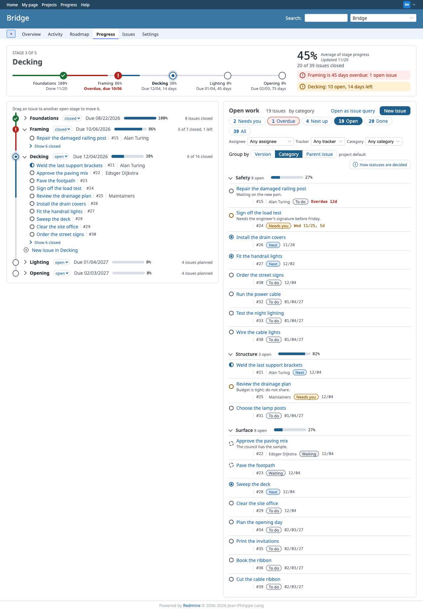
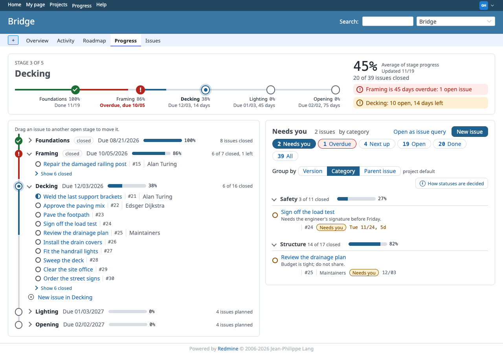
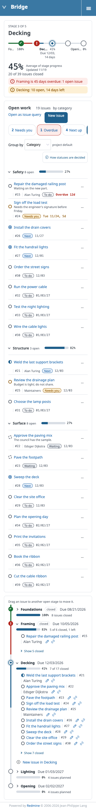
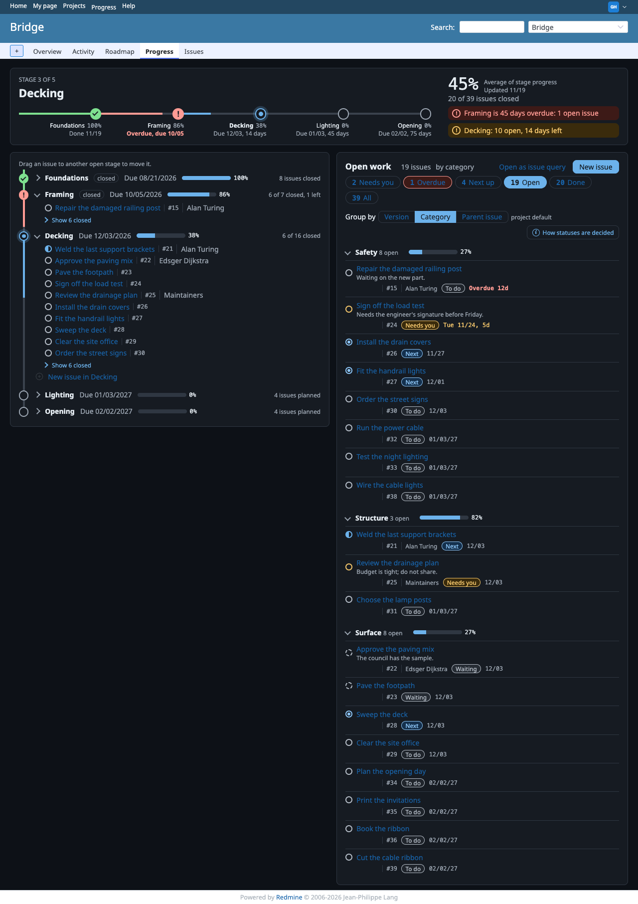
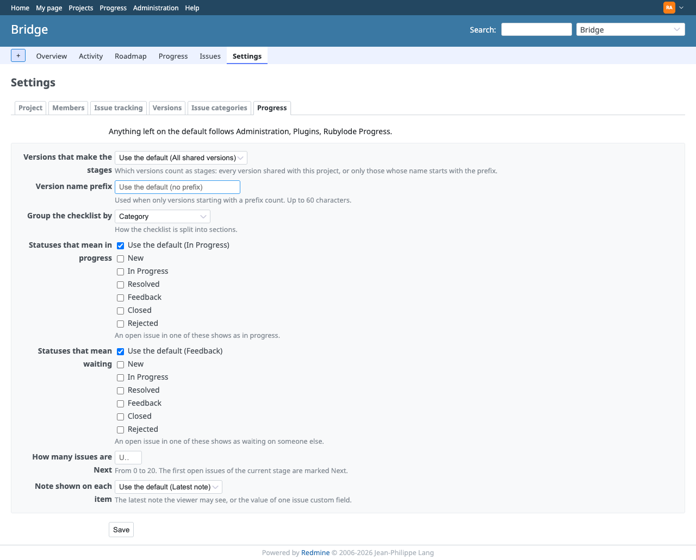
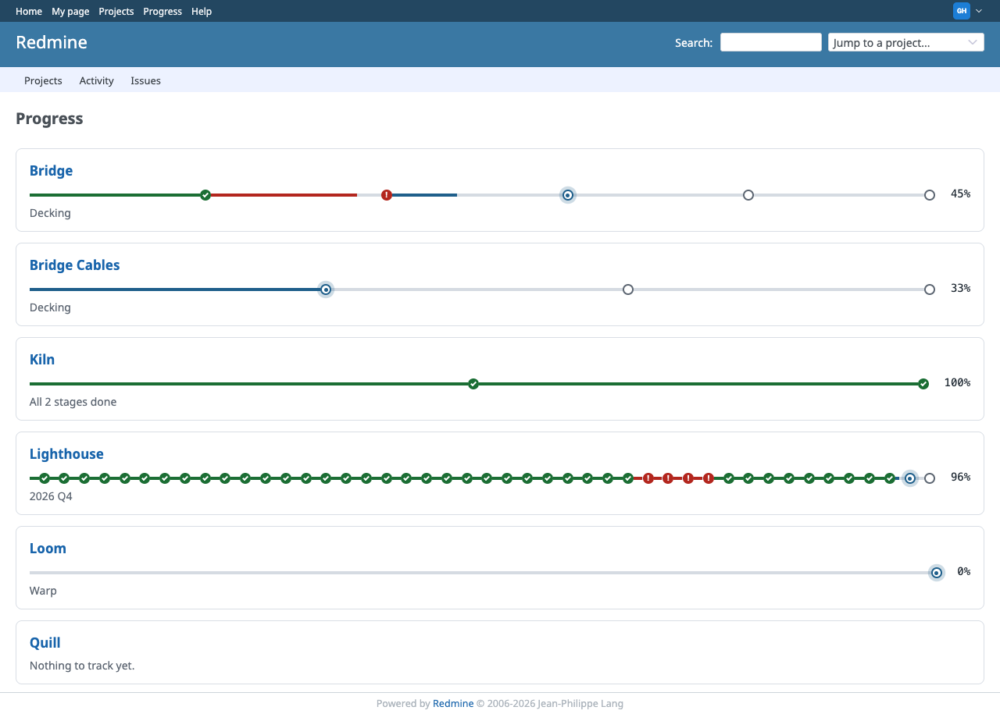

# Rubylode Progress for Redmine

TL;DR: a Progress tab for each [Redmine](https://www.redmine.org) project that answers the questions people open the Roadmap
with: how far along is it, which stage are we in, what is next, and what is waiting on me. It is built from Redmine's own
versions and issues each time the page opens, so there is nothing to keep up to date by hand, and it shows only what the
viewer may see. A second page lists every project as a compact tracker.

Version 1.0.0, needs Redmine 7.0 or newer. `docs/roadmap/ROADMAP.md` lists what is not done.

Contents:

- [What it does](#what-it-does)
- [Install](#install)
- [Enabling it](#enabling-it)
- [Settings](#settings)
- [Where it shows](#where-it-shows)
- [The rules behind the page](#the-rules-behind-the-page)
- [Editing from the page](#editing-from-the-page)
- [Restyling it](#restyling-it)
- [Troubleshooting](#troubleshooting)
- [Tests](#tests)
- [License](#license)

## What it does

The project's versions become stages on a track, in date order. At the top you see the current stage, the percent done and a
notice when a stage is overdue or close to its date. Under it, on the left, every stage with its bar and its issues as a
compact checklist; on the right, a checklist of the issues with a filter (Open, Needs you, Overdue, Next up, Done, All) and a
choice of grouping (version, category or parent issue). Each row carries a status pill, the assignee, the date and the latest
note.

A busy project stays readable. Older finished stages fold into one row of the stage list ("38 finished stages", with their
combined meter), and the top track draws them as one green mark and labels only the stages around the current one. Each
checklist section lists its first 10 issues and a "Show more" link for the rest, which is a plain link that reloads the page
without JavaScript. A long list opens section by section: with more than 8 sections only the first 5 list rows and the rest load
theirs when opened (a plain `?open=<section>` link without JavaScript). Three selects beside the status pills narrow the checklist by assignee, tracker or category: they offer
only values that occur among the issues the viewer can see, with counts, they change the pill counts with the list, and they
leave the stage list and the top track as they are. They are not remembered. Long issue notes are cut at two lines with a
"show note" link, and the overdue notice names at most three stages.

On a phone the two columns stack, and under a dark theme the page follows it.

| Phone | Dark theme |
|---|---|
|  |  |

All screenshots show the made-up projects of the demo (see [Try it](#try-it)).

## Install

Needs Redmine 7.0 or newer.

1. Put the plugin folder in Redmine's `plugins/` directory, named `redmine_rubylode_progress`:

       cd /path/to/redmine/plugins
       git clone https://github.com/rubylode/redmine-rubylode-progress.git redmine_rubylode_progress

   Or unpack `redmine_rubylode_progress-1.0.0.zip` from the release there.

2. Run `bundle exec rake redmine:plugins:migrate RAILS_ENV=production`. It adds one table, for the per-project settings.
3. Restart Redmine.

To remove it, run `bundle exec rake redmine:plugins:migrate NAME=redmine_rubylode_progress VERSION=0 RAILS_ENV=production`,
delete the folder and restart.

## Enabling it

1. In the project, open Settings, Modules, and check "Rubylode Progress".
2. In Administration, Roles and permissions, give the roles that may look at the page the permission "View progress"
   (it sits under the module's name). Without it, a non-member gets a 403, and the tab does not show.
   Changing a version's status from the page also needs Redmine's own "Manage versions" permission (see
   [Editing from the page](#editing-from-the-page)).

The Progress tab then appears in the project menu, after Roadmap.

## Settings

Plugin-wide defaults are in Administration, Plugins, Rubylode Progress, Configure. Only administrators can save them. Each
project can override them in the Progress tab of its Settings. Anyone who may edit the project (Redmine's "Edit project"
permission, which the Manager role has by default) can save that tab, with the module enabled. An empty field in the project
means "use the plugin-wide default", and the tab shows what that default is.

| Setting | Default | Meaning |
|---|---|---|
| Versions that make the stages | All shared versions | Every version shared with the project, or only those whose name starts with the prefix. |
| Version name prefix | empty | Used when only versions starting with a prefix count. Up to 60 characters. |
| Group the checklist by | Version | Version, category or parent issue. It only changes the headings, never which issues appear. |
| Statuses that mean in progress | none | An open issue in one of these shows as in progress. |
| Statuses that mean waiting | none | An open issue in one of these shows as waiting on someone else. |
| How many issues are Next | 3 | From 0 to 20. The first open issues of the current stage are marked Next. |
| Finished stages kept in the list | 3 | From 0 to 20. Older finished stages fold into one row of the stage list and one mark on the top track. A project with that many or fewer finished stages looks as before. |
| Issues listed per checklist section | 10 | From 5 to 100. The rest of a section is behind its "Show more" link and is not sent with the page. |
| Note shown on each item | Latest note | The latest note the viewer may see, or the value of one issue custom field. |

The project's tab (not the plugin-wide page) also lists the project's versions with a checkbox each, all ticked. Untick a
version to leave it out: it is not a stage and its issues are not counted. New versions are counted as they appear. The
"Versions that make the stages" rule applies first.
Every person can also pick another grouping for themselves on the page ("just for you"); that is not a setting, only a
preference of the signed-in user, and so is the filter they last chose.

## Where it shows

- The project tab "Progress", at `/projects/:id/progress`. Needs the module enabled and the permission "View progress".
- The page for all projects, at `/progress`, linked from the top menu as "Progress" for anyone who can see at least one
  project with the module enabled. One tracker for each project, in name order: the name (linking to its tab), the track, the
  percent and the current stage. A project with no versions says "Nothing to track yet".
- In the stage list the current stage and the stages left behind show their issues at once; every other stage shows its
  name, date, meter and counts, and loads its issues when it is opened, so a project with many stages and issues opens
  light. The closed issues of a current or behind stage load when its "Show N closed" fold is opened. Without JavaScript the
  "Show the N issues" link reloads the page with that stage open.

## The rules behind the page

Everything is worked out when the page opens. Nothing is stored except the settings and each person's last filter and grouping.

**Scope.** One set of issues feeds the whole page, so the numbers always agree:

- only issues the viewer may see, so every count and percent is per viewer;
- issues of the project and its subprojects (on the page for all projects each project gets its own tracker, and a parent's
  includes its subprojects);
- only issues in a counted version. An issue without a version never shows.

**Stages.** The versions shared with the project, by effective date and then name. A stage is done when none of its issues is
open and its version is closed or lies behind the current stage. A stage that still has open issues and is closed or behind the
current stage is behind: work moved on and left something. Only open and locked versions can be the current stage; a locked
version is frozen for new issues, not finished, as in Redmine's own Roadmap.

**Current stage.** The furthest version that is open and has at least one closed issue or an issue in progress. If there is
none, the first open version.

**Percent.** The sum over the stages divided by the number of stages, rounded. A stage counts 1 when it is done; otherwise the
share of its issues that are closed, so a closed or passed version with open issues counts only what was finished; and 0.5 for a
current stage with no issues. With no stages the page says there is nothing to track yet and shows no bar.

**Status of an item.** Never stored, and the first rule that matches decides:

1. Done: the issue is closed.
2. Needs you: assigned to the viewer, or to a group the viewer is in.
3. Waiting: blocked by an open issue, or in a status listed as waiting in the settings.
4. Next: in a status listed as in progress, or one of the first few remaining open issues of the current stage, by priority
   (highest first), then due date (none last), then issue number.
5. To do: everything else.

**Next limit.** "How many issues are Next" is that "first few", 3 unless changed. A status listed as in progress is Next in any stage.

**Item date.** The due date if there is one, otherwise the closed date for done items.

The box "How statuses are decided" on the page lists these rules with the statuses of the project.

## Editing from the page

All of it saves through Redmine's own issue forms, so its permissions, workflow, required fields, notifications and history
apply exactly as on the issue page, and you land back on the Progress page with the same filter. Each control shows only when
the viewer may use it.

- Pencil: after each issue in a stage and each checklist row. A modal with the status (only what the workflow allows), the assignee, % done, the
  target version and a note, and a "Full edit" link to the issue's own edit page.
- New issue: the plus on each open stage, and the New issue button above the checklist. A modal with tracker, subject,
  assignee and description, with the version set to that stage. If the project has a required custom field the modal does not
  show, you are sent to Redmine's full new issue form instead, with the version and subject filled in. Closed and locked
  versions take no new issues, so they have no plus.
- Title: clicking an issue's title shows the issue in a modal, with a link to open it in a new tab.
- Drag: drag a row to another open stage (or, when grouped by version, another section) to change its version. Only open
  versions take issues, so a closed, locked or unshared version refuses the drop and says why. Redmine decides whether the
  move is allowed. On a touch screen, where there is no dragging, use the pencil's Target version.

Without JavaScript, the pencil and the plus are plain links to Redmine's edit and new issue pages.

### Change a version's status from the page

A viewer who has Redmine's "Manage versions" permission in the version's own project sees the status tag of every stage
(open, locked or closed) as a small button with a caret. It opens a modal with the three statuses and a line on what each
means; saving it is Redmine's own version update, so Redmine's rules apply and you land back on the Progress page. Reopening
a closed stage is what makes it take dragged issues again. Everyone else sees a plain tag on closed and locked stages and
nothing on open ones. A version shared from another project needs the permission in that project.

## Restyling it

Every colour, size and gap is a CSS custom property on the page (`--rubylode-progress-accent-color` and so on). The defaults are
light, and the page never turns dark by itself inside a light theme: a dark theme sets the properties. The full list and the
dark block to paste into a dark theme are in [docs/theming.md](docs/theming.md).

## Troubleshooting

- The tab is missing: check that the module is enabled for the project and that your role has "View progress".
- The page for all projects is missing from the top menu: you can see no project that has the module enabled and gives you
  the permission.
- A version does not show as a stage: it is not shared with the project, it has no issue visible to you, or the settings count
  only names with a prefix.
- A number is lower than on the Roadmap: the page counts only what you may see, and only issues in a counted version.
- The pencil or the plus is missing on a row: you may not edit that issue, or add issues to the project. A stage has no plus
  when its version is closed or locked.
- Dropping an issue on a stage does nothing but show a sentence: the version is closed, locked or not shared with the
  issue's project. Reopen the version in Settings, Versions.
- The page looks wrong under a custom theme: set the custom properties as described in `docs/theming.md`.

## Tests

    bin/test                                         all unit and integration tests
    bin/test test/unit/percent_rule_test.rb          one file

They run in a Redmine 7 image with its test gems (`docker/test.Dockerfile`), the way the CI workflow runs them on Redmine
7.0.2 and 7.0-stable with Ruby 3.4 and 4.0. Pull Requests are welcome!

### Try it

A throwaway Redmine 7 with the plugin mounted and made-up projects (Bridge, with five versions and about forty issues, and a
few smaller ones) runs from this folder:

    ruby bin/demo up         start it and load the demo data; Redmine is on http://127.0.0.1:3016
    ruby bin/demo seed-busy  add only "Lighthouse", a busy public project (45 versions, 1000 issues); `up` loads it too
    ruby bin/demo restart    pick up a change to the plugin (it runs in production mode)
    ruby bin/demo down       stop it, keep the data
    ruby bin/demo reset      stop it and wipe the data

Sign in as `grace.hopper` with the password `demo-password-1` (a contributor who can edit issues), or as admin / admin. The data
is throwaway; never point the demo task at a real tracker.

`npm install && npm run screenshots` retakes the screenshots in `docs/screenshots` from the running demo.

### Releasing

Push a `vX.Y.Z` tag whose version matches `version` in `init.rb` and has an entry in `CHANGELOG.md`. CI runs the tests, builds
`redmine_rubylode_progress-X.Y.Z.zip` and publishes the GitHub release with the changelog entry as its notes. See
[docs/releasing.md](docs/releasing.md); the text for the listing on www.redmine.org is in
[docs/redmine-org-listing.md](docs/redmine-org-listing.md).

## License

GNU General Public License, version 2 or (at your option) any later version, the same as Redmine. See `LICENSE`.

Copyright (C) 2026  Nick Gorbikoff

No warranty, as the GPL says. The plugin only reads from your tracker, apart from the edits you make through it, which go
through Redmine's own forms. Try it on a copy of your tracker first.
