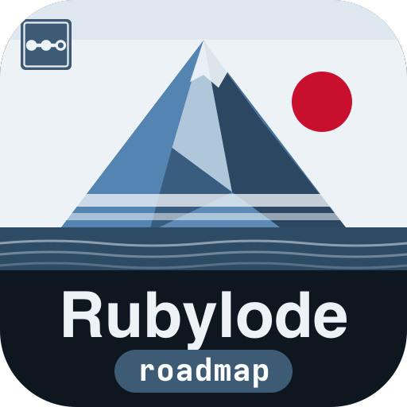

# Rubylode Progress for Redmine

TL;DR: a Progress tab for [Redmine](https://www.redmine.org) projects that reads like a parcel tracker: how far along the work
is, which stage is current, what comes next and what waits on you. It is built from Redmine's own versions and issues every
time the page opens, and it shows only what the viewer may see.

Not released yet. The design is in `docs/specs/2026-11-18-progress-page-design.md` and the build plan in
`docs/plans/progress-page/`.

## License

GNU General Public License, version 2 or (at your option) any later version. See `LICENSE`.
